# 라벨링 가이드

> **§1 치트시트만 옆에 띄워 두고 작업하세요.** 나머지는 막혔을 때 찾아보는 용도입니다.
>
> 라벨링은 기준이 갈리는 순간 전부 다시 해야 합니다. 그래서 이 문서의 규칙은
> "재질이 무엇인가"가 아니라 **"사진에서 무엇이 보이는가"** 로 씌어 있습니다.
> 사진에서 판정할 수 없는 라벨은 모델도 배울 수 없습니다.

- 라벨링은 **AI 담당 단독**입니다. 마감 **8/16** · 사진 수령은 [`task-allocation.md`](task-allocation.md)
- 라벨러가 한 명이어도 기준은 흔들립니다. **날마다 다르게 판단하는 것**이 그 형태입니다 — §6

---

## 1. 치트시트

**7종 — 판정 문장**

| 카테고리 | 판정 문장 |
|---|---|
| `CIGARETTE` | **꽁초(필터+몸통)만.** 담배갑은 `PAPER`, 셀로판은 `VINYL`, 은박은 `GENERAL` |
| `CAN` | 금속 음료·식품 캔 |
| `PLASTIC` | **구겨서 놓으면 스스로 펴지는** 성형품 — 병·컵·용기·빨대·수저 |
| `VINYL` | **구겨서 놓으면 안 펴지는** 얇은 막 — 봉지·필름·포장재 |
| `GLASS` | **바닥이 두껍고 빛이 모서리에서 꺾인다.** 눌린 자국이 있으면 유리가 아니다 |
| `PAPER` | **겉면이 종이로 보이면 전부.** 코팅·기름은 따지지 않는다 |
| `GENERAL` | 위 6종 어디에도 안 보이는 것 — 스티로폼·은박·노끈·신발·배터리 |

**라벨하지 않을 것**

1. 무엇인지 알아볼 수 없을 만큼 흐릿한 것
2. 쓰레기가 아닌 것 — 낙엽·돌·설치물·차량·사람
3. 프레임 경계에서 **절반 미만**만 보이는 것
4. **용기에 붙어 있는 뚜껑·캔따개** (§4)
5. 쓰레기통·봉투 **안에** 담긴 것 — 주울 대상이 아니다

---

## 2. 클래스별 예시

**초록 박스가 정답 박스입니다.** 물체에 얼마나 딱 맞게 치는지도 같이 보세요.

### `CIGARETTE`

젖은 것 · 타다 만 것 · 자갈에 섞인 것. 셋 다 **아주 작습니다** — 원래 그렇습니다.

| | | |
|---|---|---|
| 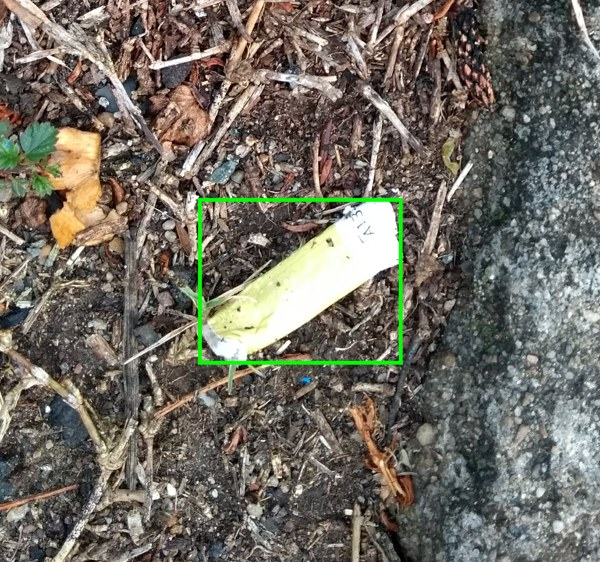 | 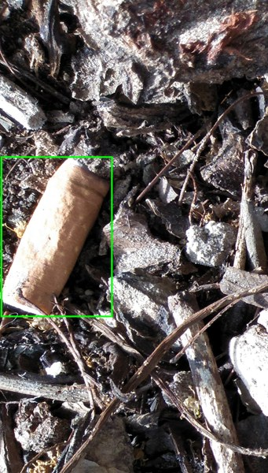 | 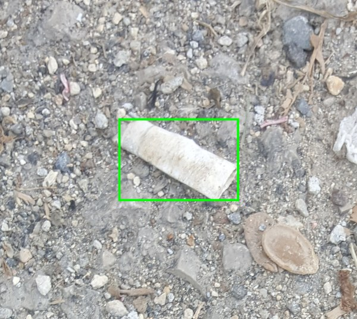 |

### `CAN`

음료캔 · 다른 쓰레기에 섞인 식품캔 · **찌그러진 캔**(형태가 무너져도 `CAN`).

| | | |
|---|---|---|
| 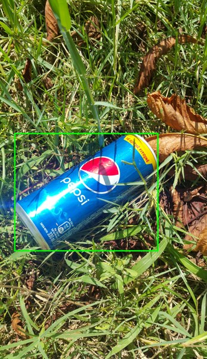 | 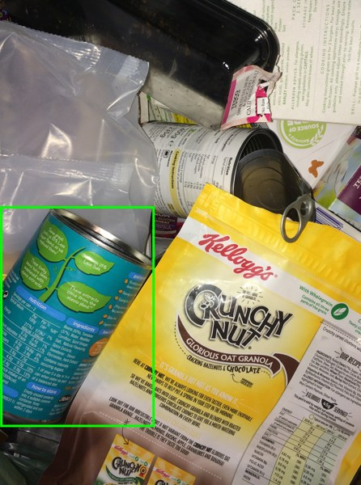 | 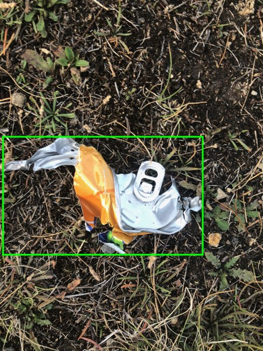 |

### `PLASTIC`

찌그러진 페트병 · 일회용 컵 · **투명 빨대**. 셋 다 눌려도 형태가 남아 있습니다.

| | | |
|---|---|---|
| 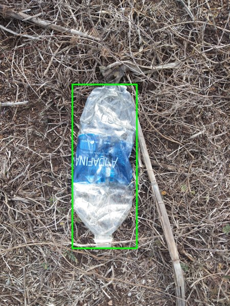 | 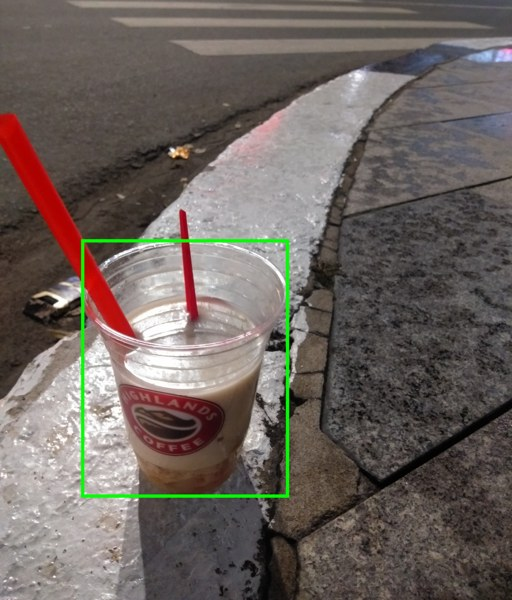 | 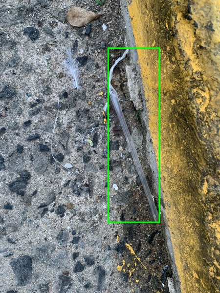 |

### `PAPER`

종이컵 · **종이팩(우유·주스)** · 전단지. 종이팩도 겉이 종이라 `PAPER` 입니다.

| | | |
|---|---|---|
| 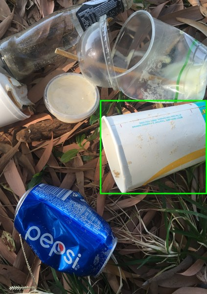 | 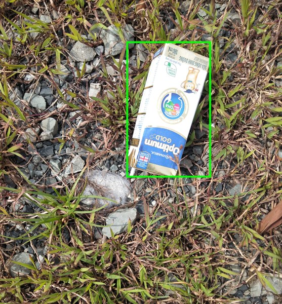 | 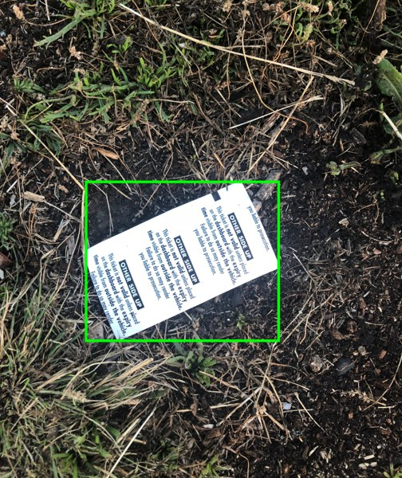 |

### `GLASS`

갈색 병 · **깨진 유리** · 투명 병. 가운데가 제일 어렵습니다 — 유리는 절반 이상이 이렇게
깨진 조각으로 나옵니다. 못 알아보겠으면 치지 마세요.

| | | |
|---|---|---|
| 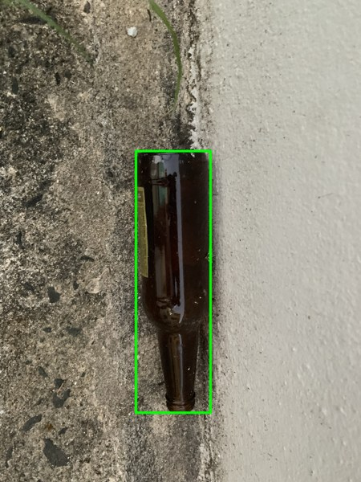 | 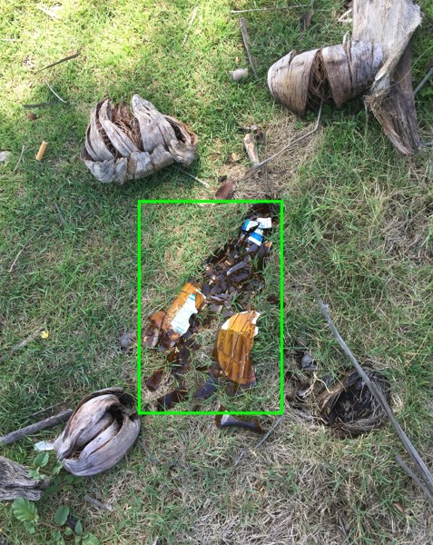 | 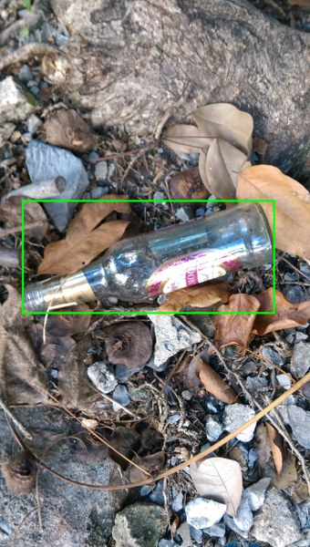 |

### `VINYL`

과자봉지 · 비닐 조각 · 쓰레기봉투. 전부 스스로 형태를 유지하지 못합니다.

| | | |
|---|---|---|
| 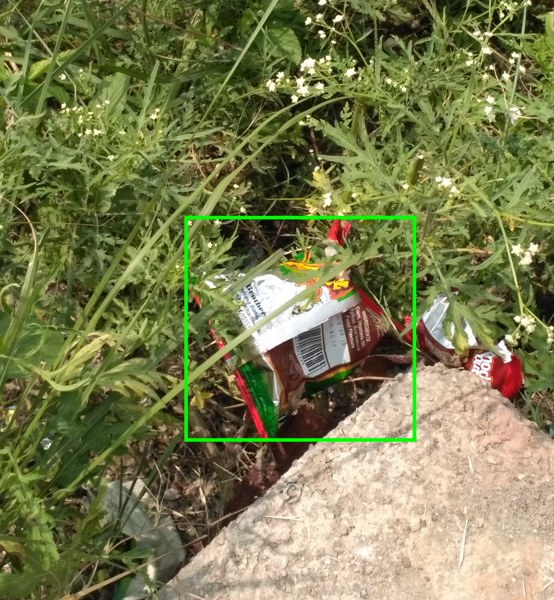 | 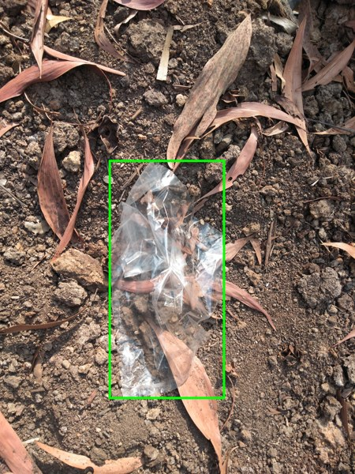 | 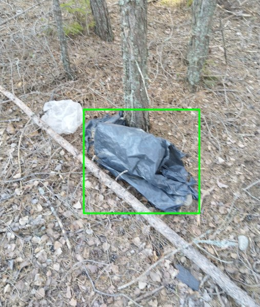 |

### `GENERAL`

스티로폼 조각 · 발포 용기 · 스티로폼 조각. **스티로폼은 플라스틱이 아니라 `GENERAL`** 입니다.

| | | |
|---|---|---|
| 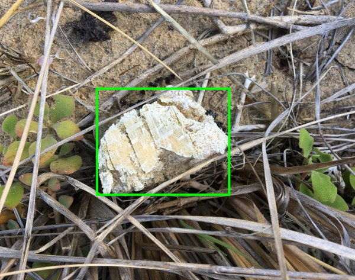 | 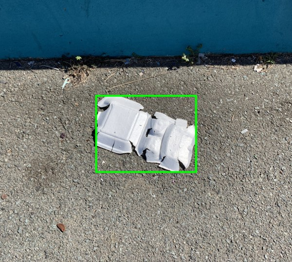 | 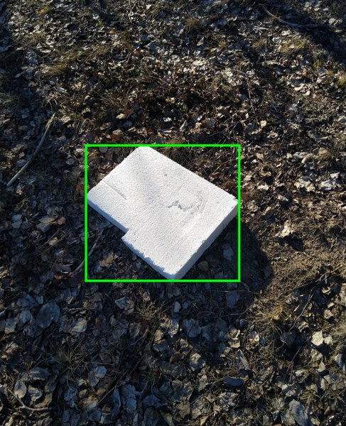 |

---

## 3. 헷갈리는 네 지점

여기가 실제로 갈리는 곳입니다. 나머지는 대개 자명합니다.

### `PLASTIC` ↔ `VINYL` — "구겨서 놓으면 스스로 펴지는가?"

펴지면 `PLASTIC`, 안 펴지면 `VINYL`.

- 페트병·요구르트병·일회용 컵·반찬통·빨대·포크 → `PLASTIC`
- 과자봉지·비닐봉지·랩·에어캡·비닐장갑 → `VINYL`
- 치약 튜브처럼 **형태를 유지하는 튜브** → `PLASTIC`

### `PLASTIC` ↔ `GLASS` — 두께와 빛

- **유리**: 벽과 바닥이 두껍고, 빛이 모서리에서 꺾여 하얗게 번쩍입니다. 목이 짧고 굵습니다
- **플라스틱**: 벽이 얇고, **눌리거나 구겨진 자국**이 있습니다. 유리는 눌리지 않습니다
- 깨진 조각이 유리인지 플라스틱인지 모르겠으면 **라벨하지 않습니다**

### `PAPER` ↔ `GENERAL` — 겉면만 봅니다

**겉면이 종이로 보이면 전부 `PAPER`** 입니다. 코팅 여부를 묻지 않습니다.

- 종이컵·우유팩·주스팩·기름 밴 피자박스·휴지·전단지 → 전부 `PAPER`
- 은박, 약 포장(블리스터), 스티로폼 → `GENERAL`

> 실제 분리배출 기준으로는 종이컵·종이팩이 별도 품목이고 오염된 종이는 일반쓰레기입니다.
> 그래도 `PAPER` 로 라벨합니다 — **사진만 보고 코팅을 판정할 수 없기 때문**입니다. 물으면
> 사람마다 답이 갈리고, 그 흔들림은 나중에 원인을 추적할 수 없습니다. (§7)

### `CIGARETTE` 범위 — 꽁초만

- 피우고 버린 **꽁초(필터+몸통)** → `CIGARETTE`
- **담배갑** → `PAPER` · **겉 셀로판** → `VINYL` · **속 은박** → `GENERAL`
- 전자담배 기기·카트리지, 미개봉 담배 → `GENERAL`

크기가 근거입니다. 꽁초는 사진에서 극히 작고 담배갑은 종이 크기라, 한 카테고리에 넣으면
모델이 "담배 = 어느 크기?"를 배우지 못합니다.

---

## 4. 박스 치는 법

| 상황 | 규칙 | 이유 |
|---|---|---|
| 가려진 물체 | **보이는 부분만** 감쌉니다. 가려진 뒤쪽을 추정해서 늘리지 않습니다 | 추정은 사람마다 달라집니다 |
| 겹친 꽁초 여러 개 | **하나씩 개별 박스.** 셀 수 있으면 셉니다 | 앱이 개수를 사용자 기록으로 씁니다 |
| 프레임에 걸친 것 | 보이는 부분이 **절반 이상**이면 라벨, 아니면 건너뜁니다 | |
| 아주 작은 것 | **크기 하한은 없습니다.** 알아볼 수 있으면 라벨합니다 | 담배꽁초가 원래 아주 작습니다. 하한을 두면 핵심 카테고리가 통째로 빠집니다 |
| 뚜껑·캔따개 | 용기에 **붙어 있으면 치지 않습니다.** 따로 떨어져 있으면 칩니다 | 안 그러면 페트병 하나가 "플라스틱 2개"로 기록됩니다 |
| 박스 크기 | 물체에 **딱 맞게**. 여백을 남기지 않습니다 | |

---

## 5. 작업 순서

1. 사진을 엽니다
2. **주울 만한 쓰레기를 전부** 찾습니다 — 작은 것부터 놓치기 쉽습니다
3. 하나씩 박스를 치고 카테고리를 고릅니다
4. 애매한 게 있으면 **라벨하지 말고** §6 으로

한 장에 5분 이상 쓰지 마세요. 오래 고민되는 건 대개 §6 감입니다.

---

## 6. 애매하면 — 기록하고 넘어갑니다

이 가이드는 모든 경우를 커버하지 못합니다. 라벨러가 한 명이면 사람 사이의 불일치는 없지만
**같은 물체를 지난주와 다르게 치는 것**이 남습니다. 그리고 그건 아무도 지적해 주지 않습니다.

1. 그 물체는 **라벨하지 않고** 넘어갑니다
2. 파일명과 무엇이 애매했는지를 [`development-log.md`](../development-log.md) 에 적습니다
3. 같은 종류가 몇 번 더 나오면 그때 정합니다 — 한 건으로 규칙을 만들지 않습니다
4. 정하면 이 문서와 진행상황 §3.2 에 한 줄이 추가됩니다

혼자 정하는 것 자체는 문제가 아닙니다. **판정이 흔들린 자리를 남기지 않는 것**이 문제입니다
— 나중에 confusion matrix 를 봐도 원인이 안 보입니다.

---

## 7. 실제 분리배출과 다른 점

앱은 "이걸 어디에 버려야 하나"가 아니라 "사진에 무엇이 보이나"를 답합니다. 그래서 아래는
**의도적으로** 규정과 다릅니다. 사용자 문의가 오면 이 목록을 근거로 답하면 됩니다.

| 물건 | 우리 라벨 | 실제 분리배출 |
|---|---|---|
| 종이컵·종이팩(우유·주스) | `PAPER` | 일반 종이와 **별도 수거** |
| 기름 밴 피자박스·오염된 종이 | `PAPER` | 일반쓰레기 |
| 스티로폼·발포 용기 | `GENERAL` | 스티로폼 **별도 수거** |
| 음식물 | `GENERAL` | 음식물쓰레기 |
| 투명 페트병 | `PLASTIC` | 투명페트 **별도 수거** |

---

**예시 사진 출처** — [TACO](http://tacodataset.org/) (CC BY 4.0). 실외 장면만 골랐습니다.
