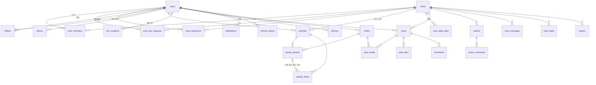

# ERD

새 DB 는 비운 채 V1 부터 시작한다(ADR-0002). 옛 스키마에서 그대로 살릴 테이블은 살리고, 동네·모임·친구 계열은 만들지 않는다.
규약은 `feature-scope.md` 와 팀 규칙을 따른다: **도메인 간에는 식별자 참조만**(JPA 연관관계 없음), 소프트 삭제는 `deleted_at`, 시각은 `timestamptz`.
PostGIS 는 경로·사진 위치에만 쓴다.

## 그림

## 도메인별 테이블

### 사용자 · 인증

**users** — 옛 테이블에서 `hood_code` · `map_visible` · `role` · `suspend_message` · `face` 를 뺀다.

| 컬럼 | 타입 | 제약 |
|---|---|---|
| id | uuid | PK |
| email | text | UNIQUE, null 가능(소셜 전용) |
| password_hash | text | |
| kakao_id · google_sub | text | 각각 UNIQUE |
| nickname | text | UNIQUE. 미완료 소셜 가입은 null, 저장 완료 후 필수. API profileComplete는 이 값의 설정 여부로 파생 |
| intro | text | NOT NULL DEFAULT '' |
| photo_media_id | uuid | → media |
| share_location_default | boolean | NOT NULL DEFAULT true — 활동 시작 시트의 초기값 |
| notify_activity_start | boolean | NOT NULL DEFAULT true — 팔로우 알림 전체 스위치 |
| status | text | ACTIVE · DELETED |
| created_at · updated_at · deleted_at | timestamptz | |

**user_agreements** — 약관·개인정보 동의 이력. 닉네임 완료 상태로 동의 완료를 대신하지 않는다. API `complete` 는 필수 `type` 마다 현재 버전 행의 `agreed` 가 true 인지로 파생한다.

| 컬럼 | 타입 | 제약 |
|---|---|---|
| user_id | uuid | → users |
| type | text | TERMS · PRIVACY · MARKETING |
| version | text | 동의한 문서 버전 |
| agreed | boolean | NOT NULL. 선택 항목 철회는 false 로 갱신 |
| agreed_at | timestamptz | |
| PK | | (user_id, type, version) |

비밀번호 재설정 성공 시 모든 기기의 access/refresh 세션을 무효화하고 재로그인을 요구한다. 소셜 전용 계정에 새 비밀번호를 만드는 기능은 없다. 세션 무효화의 실제 저장/검증 방식은 구현에서 결정한다.

**refresh_tokens** — 이관한 `auth` Entity 그대로.

**password_reset_tokens** — 메일로 보낸 6자리 코드 한 장이 한 행이다. 새로 보내면 그 사용자의 쓰지 않은 행은 `used_at` 이 찍혀 무효가 된다(V2).

| 컬럼 | 타입 | 제약 |
|---|---|---|
| id | bigint | PK, identity |
| user_id | uuid | NOT NULL → users. 행은 이것으로 찾는다 |
| token_hash | text | NOT NULL. `user_id` 를 섞은 코드의 해시. 6자리 코드는 겹칠 수 있어 유일하지 않다 |
| expires_at | timestamptz | NOT NULL. 발급 + 10분 |
| used_at | timestamptz | 사용·재발급·오답 한도 초과로 폐기된 시각 |
| failed_attempts | integer | NOT NULL DEFAULT 0. 5에 닿으면 `used_at` 을 찍어 폐기 |
| created_at | timestamptz | NOT NULL |

**devices** — `PUT /users/me/devices`. 같은 기기에 다른 계정으로 로그인하면 토큰의 주인이 바뀐다.

| 컬럼 | 타입 | 제약 |
|---|---|---|
| push_token | text | PK |
| user_id | uuid | NOT NULL → users |
| platform | text | NOT NULL. `ANDROID`(iOS 는 이후) |
| created_at · updated_at | timestamptz | |

**media** — 옛 것 그대로(`owner_id` · `object_key` · `thumb_key`).

### 크루

**crews**

| 컬럼 | 타입 | 제약 |
|---|---|---|
| id | uuid | PK |
| name | text | NOT NULL. 살아 있는 크루끼리 UNIQUE(부분 UNIQUE WHERE deleted_at IS NULL) — 해산한 크루의 이름은 다시 쓸 수 있다. 앞뒤 공백·줄바꿈 제거 뒤 저장. 중복은 API 409 CREW_NAME_TAKEN |
| intro | text | NOT NULL DEFAULT ''. 크루 설명 |
| photo_media_id | uuid | → media |
| leader_id | uuid | NOT NULL → users. 크루장은 한 명(Q21) |
| region | text | NOT NULL. 활동 지역 — 시·도 코드 17개(SEOUL · BUSAN · … · JEJU, 목록은 openapi `Region`). 크루의 설명이며 사람의 소속 단위가 아니다. 크루장이 바꿀 수 있다 |
| join_policy | text | NOT NULL. OPEN(공개 — 바로 가입) · APPROVAL(비공개 — 크루장 승인). 검색 노출과 무관. 기본값 없음. 크루장이 바꿀 수 있다 |
| goal_count | int | NOT NULL DEFAULT 200 — 최근 14일 목표(Q19·20). 창 길이 14 는 코드 상수 |
| created_at · updated_at · deleted_at | timestamptz | |

**crew_members** — 현재 소속만. 이력은 `activities.crew_id` 가 대신한다(Q13).

| 컬럼 | 타입 | 제약 |
|---|---|---|
| crew_id | uuid | → crews |
| user_id | uuid | → users, **UNIQUE** (한 사람 한 크루, Q22) |
| joined_at | timestamptz | NOT NULL |
| | | PK (crew_id, user_id) |

혼자 남은 크루장은 해산 확인 후 크루 나가기·회원 탈퇴가 가능하며 크루를 소프트 삭제한다. 다른 크루원이 있으면 먼저 위임한다. 진행 중 활동이나 계정별 로컬 미동기화 활동이 있으면 나가기·회원 탈퇴·로그아웃을 막는다. 크루를 나간 뒤 이전 크루 활동은 지워지지 않으며, 본인은 소속이 없어도 이전 크루 것까지 본다(`/users/me/activities`·`/users/me/stats`).

초대 코드는 없다. 크루 검색(`GET /crews`)에서 고른 크루로 가입한다. 공개 크루는 `crew_members` 행을 바로 넣고, 비공개 크루는 `crew_join_requests` 에 PENDING 행을 넣어 크루장 승인 때 `crew_members` 를 넣는다. PENDING 인 사람은 `crew_members` 에 없다 — 크루원이 아니다.

- **정원** — `crew_members` 가 크루장 포함 50행이면 더 넣지 않는다(API 409 CREW_FULL). PENDING 은 세지 않는다. 검사는 공개 크루 가입·비공개 크루 가입 신청·가입 승인·공개 전환에서 한다. 공개 전환은 기존 크루원 + PENDING 이 50 을 넘으면 전환 자체를 거부한다(일부만 넣지 않는다). 정원이 찬 크루에 이미 있던 PENDING 은 자동 취소하지 않는다. 동시성은 아래 "크루 정원 — 크루별로 직렬화한다"
- **개발 데이터** — 이 스키마를 넣는 migration 은 기존 개발 DB 의 크루 관련 행을 지우고 시드로 다시 만든다(운영 데이터 없음)
- **추방** — `crew_expulsions` 에 남는 행이 있으면 그 크루의 공개 가입과 비공개 가입 신청을 모두 막는다(403 EXPELLED_FROM_CREW). 공개 전환 자동 가입도 같은 행을 확인해 추방자의 PENDING 은 넣지 않는다. 행을 지워 제한을 푸는 기능은 없다
- **거절 뒤 재신청** — 막지 않는다. 기다림 없음

**crew_join_requests**

| 컬럼 | 타입 | 제약 |
|---|---|---|
| id | uuid | PK |
| crew_id · user_id | uuid | |
| status | text | PENDING · APPROVED · REJECTED · CANCELED |
| decided_by | uuid | → users(크루장). 공개 크루 가입은 null. 공개 전환 자동 가입은 전환한 크루장 |
| created_at · decided_at | timestamptz | |
| rejection_read_at | timestamptz | REJECTED 의 거절 안내를 신청자가 확인한 시각. 그 사람의 **가장 최근** 신청이 REJECTED 이고 이 값이 null 일 때만 `GET /users/me` 의 `membership.rejection` 으로 내려간다 — 대기 취소와 거절이 엇갈려 남은 옛 미확인 거절은 다시 띄우지 않는다 |
| | | 부분 UNIQUE (user_id) WHERE status = 'PENDING' — 승인 대기는 한 사람에 한 건 |

공개 크루 가입도 이 테이블에 APPROVED 행(`decided_by` null, `decided_at` = `created_at`)으로 남긴다. `POST /crews/join-requests` 응답과 `GET /crews/join-requests/mine` 이 공개·비공개를 같은 `JoinRequest` 로 돌려주기 위해서다.

PENDING 이 있는 사람의 크루 만들기·다른 크루 가입·신청은 409 JOIN_REQUEST_PENDING 이다. 신청을 CANCELED 로 바꾸는 것은 신청자의 직접 취소(`DELETE /crews/join-requests/mine`)와 회원 탈퇴(`DELETE /users/me`, 그 사람의 PENDING 전부)뿐이다. CANCELED 는 승인·공개 전환 자동 가입 대상이 아니다.

**crew_expulsions** — 추방 이력. 크루원 추방(`DELETE /crew/members/{userId}`, 신고 처리의 추방 포함) 때 넣는다.

| 컬럼 | 타입 | 제약 |
|---|---|---|
| crew_id | uuid | → crews |
| user_id | uuid | → users |
| expelled_by | uuid | → users(크루장) |
| expelled_at | timestamptz | NOT NULL |
| | | PK (crew_id, user_id) — 다시 추방되면 `expelled_at` 갱신 |

### 사람 사이

**follows** — 한 방향, 알림 전용(Q14).

| 컬럼 | 제약 |
|---|---|
| follower_id · followee_id | → users, PK (둘), CHECK 자기 자신 아님 |
| created_at | |

**blocks** — 한 방향. 차단자의 개인 게시물·댓글·채팅·위치 조회에서 대상만 숨긴다. 상대방 조회에 대칭 적용하지 않는다. 공식 공지와 필요한 크루장 관리 정보는 유지한다.

| 컬럼 | 제약 |
|---|---|
| blocker_id · blocked_id | → users, PK (둘), CHECK 자기 자신 아님 |
| created_at | |

### 활동

**activities** — `meet_id` · `type` · `title` · `gps_weak` 를 빼고 `crew_id` · 진행 상태 · 일시정지를 넣는다.

| 컬럼 | 타입 | 제약 |
|---|---|---|
| id | uuid | PK |
| user_id | uuid | NOT NULL → users |
| crew_id | uuid | NOT NULL → crews. **시작 당시 소속**. 탈퇴·추방 뒤에도 그대로(Q13) |
| status | text | IN_PROGRESS · ENDED |
| started_at | timestamptz | NOT NULL |
| ended_at | timestamptz | ENDED 면 NOT NULL |
| duration_sec | int | 일시정지 제외한 누적(Q30) |
| paused_sec | int | 일시정지 누적 |
| paused | boolean | NOT NULL DEFAULT false. 재실행 상태 복원; 종료 시 false |
| paused_at | timestamptz | 일시정지 시작 시각. 재개·종료 시 null |
| distance_m | int | 필터·걸음수 보정 뒤 값(Q31) |
| steps | int | 선택 측정값, 미측정 null. 일시정지 걸음수 제외. 권한 부재·비보행 활동도 저장하며 사용할 수 없는 0/null로 GPS 보정하지 않음 |
| route | geometry(LineString, 4326) | |
| location_shared | boolean | NOT NULL — 시작 시트의 선택(Q16) |
| item_count | int | 줍기 수량 합 |
| by_category | jsonb | 카테고리별 수량 합 |
| created_at · deleted_at | timestamptz | |
| | | 부분 UNIQUE (user_id) WHERE status = 'IN_PROGRESS' |

**activity_photos** — `POST /media` 의 `purpose=ACTIVITY` 가 만든다. 옛 `hood_code` · `sido/sigungu/dong` 은 없다.

| 컬럼 | 타입 | 제약 |
|---|---|---|
| id | uuid | PK. API `photoId` |
| activity_id | uuid | NOT NULL → activities |
| media_id | uuid | NOT NULL UNIQUE → media |
| point | geometry(Point, 4326) | 촬영 위치. 없으면 null |
| taken_at | timestamptz | NOT NULL |
| inference_status | text | NOT NULL. OK · UNAVAILABLE — 추론이 실패해도 사진은 남긴다 |
| model_version | text | UNAVAILABLE 면 null |
| inference_ms | int | UNAVAILABLE 면 null |
| order_index | int | NOT NULL |
| created_at | timestamptz | |

**activity_items** — 사진 없는 빠른 줍기(Q29)를 허용한다.

| 컬럼 | 타입 | 제약 |
|---|---|---|
| id | uuid | PK. 앱의 ItemInput.id 그대로; 동일 UUID 재전송 멱등 |
| activity_id | uuid | NOT NULL → activities |
| photo_id | uuid | → activity_photos, **null 가능** |
| bbox_x·y·w·h | real | 좌표는 전부 null 또는 전부 설정. 설정 시 photo_id 필수. 사진 업로드 후 수동 분류는 bbox 없이 허용 |
| ai_predicted_category | text | 7종 |
| ai_confidence | real | |
| final_category | text | 7종 NOT NULL |
| quantity | int | NOT NULL DEFAULT 1 CHECK > 0 — 빠른 줍기 연타·수량 수정 |
| unclassified | boolean | NOT NULL |
| source | text | AI · MANUAL |

`pickup_point_id` 는 동네 지도용이라 뺀다. 빠른 줍기는 앱이 UUID를 즉시 영속 저장 후 전송한다. 되돌리기는 미전송 건 취소 또는 저장된 UUID 삭제다. 종료 전에 줍기 큐를 먼저 처리하고, 같은 활동 UUID 종료 재전송은 기존 결과 반환 및 집계 중복 방지. 이전 종료 동기화 전 새 활동을 시작하지 않는다.

**live_locations** — 활동 중인 크루원의 현재 위치(Q16). 활동 종료 때 행을 지운다. 갱신이 5초마다라 Redis 로 옮겨도 된다. 우선 테이블로 두고 부하가 보이면 바꾼다.

| 컬럼 | 제약 |
|---|---|
| user_id | PK → users |
| activity_id | → activities |
| crew_id | 조회 키 |
| point | geometry(Point, 4326). 대상이 IN_PROGRESS이고 location_shared=true인 경우만 제공 |
| paused | boolean |
| distance_m · item_count · elapsed_sec | 목록 화면(2-2) 표시용 |
| updated_at | |

조회자는 활동 중일 필요 없다. 일시정지 중에도 위치 공유·줍기는 가능하되 거리·시간·걸음수 누적은 멈춘다.

### 피드

**posts** — `record_id` · `record_scope` 를 빼고 `crew_id` 를 넣는다. 활동 요약은 `post_media` 의 이미지일 뿐(Q24).

| 컬럼 | 타입 | 제약 |
|---|---|---|
| id | uuid | PK |
| crew_id | uuid | NOT NULL — 작성 당시 소속 |
| author_id | uuid | NOT NULL → users |
| text | text | ≤ 1000 |
| visibility | text | CREW · PRIVATE |
| created_at · updated_at · deleted_at | timestamptz | |
| deleted_by | uuid | 크루장이 지웠으면 그 사람(Q39) |

**post_media** — 게시물당 10장까지.

| 컬럼 | 제약 |
|---|---|
| post_id | → posts |
| media_id | → media |
| order_index | NOT NULL |
| | PK (post_id, media_id), UNIQUE (post_id, order_index) |

**post_likes** — 옛 `post_thanks` 개명. (post_id, user_id) PK 둘, created_at.

**comments** — 수정 기능이 없어 `updated_at` 이 없다.

| 컬럼 | 타입 | 제약 |
|---|---|---|
| id | uuid | PK. 앱 생성, 같은 id 재전송 멱등 |
| post_id | uuid | NOT NULL → posts |
| author_id | uuid | NOT NULL → users |
| text | text | NOT NULL, ≤ 500 |
| created_at · deleted_at | timestamptz | |
| deleted_by | uuid | 크루장이 지웠으면 그 사람(Q39) |

### 크루 운영

**notices**

| 컬럼 | 타입 | 제약 |
|---|---|---|
| id | uuid | PK |
| crew_id | uuid | NOT NULL |
| author_id | uuid | NOT NULL |
| title | text | ≤ 100 |
| body | text | ≤ 3000 |
| created_at · updated_at · deleted_at | timestamptz | |

삭제되지 않은 최신 공지 한 건을 자동 노출한다. 수동 고정 컬럼은 없으며 API `pinned`/`pinnedNotice`는 최신 공지 여부/내용을 파생한다.

**notice_comments** — `comments` 와 같은 모양, `notice_id`.

**chat_messages** — 텍스트만(사진은 피드로). `seq` 는 크루별 정렬·이어받기 키(`realtime.md`).

| 컬럼 | 타입 | 제약 |
|---|---|---|
| id | uuid | PK. 앱 생성, 같은 id 재전송 멱등 |
| crew_id | uuid | NOT NULL → crews |
| seq | bigint | NOT NULL. 크루 안에서 1씩 증가 |
| author_id | uuid | NOT NULL → users |
| text | text | NOT NULL, ≤ 500 |
| created_at · deleted_at | timestamptz | |
| deleted_by | uuid | 크루장이 신고 처리로 지웠으면 그 사람(`CHAT_DELETED`) |
| | | UNIQUE (crew_id, seq) |

**chat_reads** — (crew_id, user_id) PK, last_seq bigint NOT NULL, updated_at.

**reports**

| 컬럼 | 제약 |
|---|---|
| id | PK |
| crew_id | 어느 크루장에게 가는지 |
| reporter_id | → users |
| target_type | USER · POST · COMMENT · NOTICE_COMMENT · CHAT_MESSAGE |
| target_id | text |
| reason | SPAM · HATE · INAPPROPRIATE_PHOTO · PRIVACY · OTHER |
| memo | |
| status | PENDING · RESOLVED |
| result | DELETE · DISMISS (Q39). 사용자 추방 시 해당 크루·대상의 PENDING USER 신고를 모두 RESOLVED 처리(결과 null). USER 무조치는 DISMISS |
| resolved_by · resolved_at | |
| | UNIQUE (reporter_id, target_type, target_id) |

신고 처리·추방 시 각 신고자에게 결과 `REPORT_RESOLVED` 알림을 보낸다. 결과 설명은 title/detail에 담고 알림 목록으로 이동한다.

### 알림

**notifications** — `type` 을 새 발생원으로 바꾼다.

| 컬럼 | 제약 |
|---|---|
| id | PK |
| user_id | 받는 사람 |
| type | JOIN_REQUEST · CREW_JOINED · JOIN_APPROVED · JOIN_REJECTED · NOTICE · COMMENT · CHAT · ACTIVITY_STARTED · REPORT · REPORT_RESOLVED · POST_REMOVED |
| title · detail | |
| unread | |
| target_type · target_id | 이동 대상(2-3 의 규칙) |
| created_at | |

## 회원 탈퇴 때 (Q32)

`users.status = DELETED`, 닉네임·이메일·소셜 식별자·사진을 지운다. 그 사람의 PENDING 가입 신청은 모두 CANCELED 로 바꾼다(크루장 3-8 목록·공개 전환 대상에서 빠진다). `activities` 는 행을 지우되 크루 합산을 보존하기 위해 **크루별·일별 합산을 `crew_daily_stats` 에 적립**해 둔다.

| 컬럼 | 타입 | 제약 |
|---|---|---|
| crew_id | uuid | → crews |
| date | date | KST |
| item_count · distance_m · duration_sec · activity_count | int | NOT NULL DEFAULT 0 |
| by_category | jsonb | NOT NULL DEFAULT '{}' |
| | | PK (crew_id, date) |

이 표는 홈 카드·캐릭터·크루 기록의 집계 원본이며 활동 종료 시 멱등 갱신한다. 회원 탈퇴 시 이미 반영된 활동을 재가산하지 않고 보존한다. 시간·활동 횟수도 삭제 후 보존한다. 날짜는 KST, 주간은 이번 월요일부터, 월간은 이번 달 1일부터이며 ALL 추이는 월별이다. 순위는 줍기 수량 기준 공동 순위, 달력은 사람 수 대신 활동 횟수다. `posts` · `comments` 는 남기고 작성자 표시만 "탈퇴한 크루원" 으로.

## 만들지 않는 옛 테이블

meets · meet_members · meet_invites · meet_join_requests · friendships · neighborhoods · pickup_points · hidden_posts · audit_logs · export_histories · daily_active_users

## 인덱스 메모

- `activities (crew_id, started_at)` — 달력·순위
- `crew_daily_stats (crew_id, date)` — 홈 카드·캐릭터·크루 기록 추이
- `activities (user_id, started_at)` — 개인 기록
- `posts (crew_id, visibility, created_at)` — 피드
- `chat_messages (crew_id, seq)` — 채팅 이어받기
- `notifications (user_id, unread, created_at)`
- `live_locations (crew_id)`

## 설계 근거

테이블 정의만으로는 보이지 않는 결정의 이유. 통계의 날짜 기준(KST·주간·월간)은 위 `crew_daily_stats` 설명이 정본이다.

### 채팅 seq — 발급 순서와 커밋 순서를 맞춘다

재연결 뒤 이어받기는 `afterSeq` 커서다(`realtime.md`). 그런데 seq 를 먼저 받은 메시지가 늦게 커밋될 수 있다 — seq 5 가 seq 4 보다 먼저 커밋되면, 이어받기가 5 까지 읽고 다음에 `afterSeq=5` 로 묻는 사이 4 는 영영 내려가지 않는다.

그래서 **같은 크루의 메시지 저장을 직렬화**해 seq 순서와 커밋 순서를 같게 만든다. 저장 트랜잭션이 먼저 크루 단위 advisory lock(`pg_advisory_xact_lock`, 키는 `crew_id`)을 잡고 그 크루의 다음 seq 를 발급한다. 크루 하나의 동시 발화는 적어 경합은 무시할 수준이다. `UNIQUE (crew_id, seq)` 가 마지막 방어선이다.

### 크루 정원 — 크루별로 직렬화한다

정원 50명은 "세고 넣는" 두 단계라, 같은 크루에 공개 가입·승인·공개 전환 자동 가입이 동시에 오면 둘 다 49명을 보고 51명이 된다. 그래서 크루원을 넣는 트랜잭션은 먼저 그 크루 행을 잠그고(`SELECT … FROM crews WHERE id = ? FOR UPDATE`) 센 뒤 넣는다. 채팅 seq 처럼 크루 단위 잠금이고, 크루 하나의 가입은 드물어 경합은 무시할 수준이다. 공개 전환은 같은 잠금 안에서 크루원 + 대기 신청 수를 세고, 50 이하일 때만 대기 신청 전부를 처리한다. 비공개 크루 가입 신청도 같은 잠금 안에서 센다.

### 활동 중 위치 — 테이블로 시작한다

`live_locations` 는 사람당 한 행(`user_id` PK)을 5초마다 덮어쓰고, 활동 종료 때 지운다. 옛 저장소는 반경 검색(GEO)과 자동 만료 때문에 위치를 Redis 에 두었지만, 지금은 **크루 범위로만 조회**하므로 반경 검색이 없고 `live_locations (crew_id)` 인덱스 하나로 끝난다. 행 수도 동시에 활동 중인 사람 수를 넘지 않는다.

5초 덮어쓰기가 DB 쓰기 부하로 보이면 Redis 로 옮긴다. 옮기면 live 도메인의 `repository/` 에 Redis 어댑터를 두고, Postgres 결과와 섞는 조회는 트랜잭션 밖에서 한다(`backend/docs/02-conventions.md` §10).

## 보존·정리

스케줄 작업은 단일 인스턴스 전제로 `@Scheduled` 를 쓴다(`global/config/SchedulingConfig`). 서버를 여러 대로 늘리면 그때 분산 잠금을 붙인다.

| 대상 | 언제 | 무엇을 | 상태 |
|---|---|---|---|
| `refresh_tokens` | 매일 04:00 KST | 만료 후 30일 지난 행 삭제 (`RefreshTokenCleanupJob`) | 있음 |
| 삭제된 콘텐츠의 사진 | 삭제 커밋 뒤 | 스토리지에서 `deleted/` 경로로 옮긴다 (`MediaQuarantineListener`) | 리스너만 있음. 발행은 각 도메인이 삭제를 만들 때 |
| `live_locations` | 활동 종료 때 | 그 사람의 행 삭제 | 구현 전 |
| 종료 없이 끊긴 `live_locations` | — | 앱이 종료를 못 보낸 채 갱신이 끊긴 행 | **미정** |
| `password_reset_tokens` | — | 만료·사용된 행 | **미정** — 지금은 쌓이기만 한다 |
| `deleted_at` 이 찍힌 행 | — | 물리 삭제 여부와 기간 | **미정** — 지금은 소프트 삭제로 남는다 |
| 줍기에 연결되지 않은 활동 사진 | — | — | **미결** (`feature-scope.md` §미결) |
