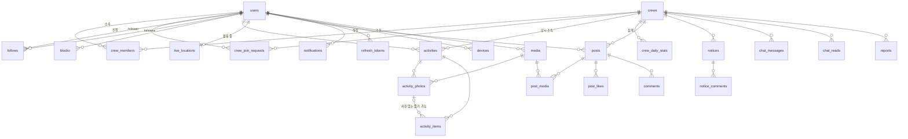

# ERD

새 DB 는 비운 채 V1 부터 시작한다(ADR-0002). 옛 스키마에서 그대로 살릴 테이블은 살리고, 동네·모임·친구 계열은 만들지 않는다.
규약은 `기능범위.md` 와 팀 규칙을 따른다: **도메인 간에는 식별자 참조만**(JPA 연관관계 없음), 소프트 삭제는 `deleted_at`, 시각은 `timestamptz`.
PostGIS 는 경로·사진 위치에만 쓴다.

## 그림

## 도메인별 테이블

### 사용자 · 인증

**users** — 옛 테이블에서 `hood_code` · `map_visible` · `role` · `suspend_message` · `face` 를 뺀다.

| 컬럼 | 타입 | 제약 |
|---|---|---|
| id | uuid | PK |
| email | text | UNIQUE, null 가능(소셜 전용) |
| password_hash | text | |
| kakao_id · google_sub | text | 각각 UNIQUE |
| nickname | text | UNIQUE NOT NULL |
| intro | text | NOT NULL DEFAULT '' |
| photo_media_id | uuid | → media |
| share_location_default | boolean | NOT NULL DEFAULT true — 활동 시작 시트의 초기값 |
| notify_activity_start | boolean | NOT NULL DEFAULT true — 팔로우 알림 전체 스위치 |
| status | text | ACTIVE · DELETED |
| created_at · updated_at · deleted_at | timestamptz | |

**refresh_tokens** · **password_reset_tokens** · **devices** — 옛 것 그대로. `devices.platform` 은 `ANDROID`(iOS 는 이후).

**media** — 옛 것 그대로(`owner_id` · `object_key` · `thumb_key`).

### 크루

**crews**

| 컬럼 | 타입 | 제약 |
|---|---|---|
| id | uuid | PK |
| name | text | UNIQUE NOT NULL |
| intro | text | NOT NULL DEFAULT '' |
| photo_media_id | uuid | → media |
| leader_id | uuid | NOT NULL → users. 크루장은 한 명(Q21) |
| invite_code | text | UNIQUE NOT NULL. 재발급하면 바뀐다 |
| goal_count | int | NOT NULL DEFAULT 200 — 최근 14일 목표(Q19·20). 창 길이 14 는 코드 상수 |
| created_at · updated_at · deleted_at | timestamptz | |

**crew_members** — 현재 소속만. 이력은 `activities.crew_id` 가 대신한다(Q13).

| 컬럼 | 타입 | 제약 |
|---|---|---|
| crew_id | uuid | → crews |
| user_id | uuid | → users, **UNIQUE** (한 사람 한 크루, Q22) |
| joined_at | timestamptz | NOT NULL |
| | | PK (crew_id, user_id) |

추방·탈퇴로 크루원이 0명이 되면 크루를 소프트 삭제한다. 추방된 사람도 다시 가입 신청할 수 있고 승인은 크루장 몫이다.

**crew_join_requests**

| 컬럼 | 타입 | 제약 |
|---|---|---|
| id | uuid | PK |
| crew_id · user_id | uuid | |
| status | text | PENDING · APPROVED · REJECTED · CANCELED |
| decided_by | uuid | → users(크루장) |
| created_at · decided_at | timestamptz | |
| | | 부분 UNIQUE (user_id) WHERE status = 'PENDING' — 동시에 한 건만 |

### 사람 사이

**follows** — 한 방향, 알림 전용(Q14).

| 컬럼 | 제약 |
|---|---|
| follower_id · followee_id | → users, PK (둘), CHECK 자기 자신 아님 |
| created_at | |

**blocks** — 옛 것 그대로.

### 활동

**activities** — `meet_id` · `type` · `title` · `gps_weak` 를 빼고 `crew_id` · 진행 상태 · 일시정지를 넣는다.

| 컬럼 | 타입 | 제약 |
|---|---|---|
| id | uuid | PK |
| user_id | uuid | NOT NULL → users |
| crew_id | uuid | NOT NULL → crews. **시작 당시 소속**. 탈퇴·추방 뒤에도 그대로(Q13) |
| status | text | IN_PROGRESS · ENDED |
| started_at | timestamptz | NOT NULL |
| ended_at | timestamptz | ENDED 면 NOT NULL |
| duration_sec | int | 일시정지 제외한 누적(Q30) |
| paused_sec | int | 일시정지 누적 |
| distance_m | int | 필터·걸음수 보정 뒤 값(Q31) |
| steps | int | Health Connect 걸음수. 없으면 null. 보정 근거를 남긴다 |
| route | geometry(LineString, 4326) | |
| location_shared | boolean | NOT NULL — 시작 시트의 선택(Q16) |
| item_count | int | 줍기 수량 합 |
| by_category | jsonb | 카테고리별 수량 합 |
| created_at · deleted_at | timestamptz | |
| | | 부분 UNIQUE (user_id) WHERE status = 'IN_PROGRESS' |

**activity_photos** — `hood_code` · `sido/sigungu/dong` 을 뺀다. 나머지(`media_id` · `point` · `taken_at` · `model_version` · `inference_ms` · `inference_source` · `order_index`) 그대로.

**activity_items** — 사진 없는 빠른 줍기(Q29)를 허용한다.

| 컬럼 | 타입 | 제약 |
|---|---|---|
| id | bigint | PK |
| activity_id | uuid | NOT NULL → activities |
| photo_id | uuid | → activity_photos, **null 가능** |
| bbox_x·y·w·h | real | photo_id 있을 때만. CHECK (photo_id IS NULL) = (bbox_x IS NULL) |
| ai_predicted_category | text | 7종 |
| ai_confidence | real | |
| final_category | text | 7종 NOT NULL |
| quantity | int | NOT NULL DEFAULT 1 CHECK > 0 — 빠른 줍기 연타·수량 수정 |
| unclassified | boolean | NOT NULL |
| source | text | AI · MANUAL |

`pickup_point_id` 는 동네 지도용이라 뺀다.

**live_locations** — 활동 중인 크루원의 현재 위치(Q16). 활동 종료 때 행을 지운다. 갱신이 5초마다라 Redis 로 옮겨도 된다. 우선 테이블로 두고 부하가 보이면 바꾼다.

| 컬럼 | 제약 |
|---|---|
| user_id | PK → users |
| activity_id | → activities |
| crew_id | 조회 키 |
| point | geometry(Point, 4326) |
| paused | boolean |
| distance_m · item_count · elapsed_sec | 목록 화면(2-2) 표시용 |
| updated_at | |

### 피드

**posts** — `record_id` · `record_scope` 를 빼고 `crew_id` 를 넣는다. 활동 요약은 `post_media` 의 이미지일 뿐(Q24).

| 컬럼 | 타입 | 제약 |
|---|---|---|
| id | uuid | PK |
| crew_id | uuid | NOT NULL — 작성 당시 소속 |
| author_id | uuid | NOT NULL → users |
| text | text | ≤ 1000 |
| visibility | text | CREW · PRIVATE |
| created_at · updated_at · deleted_at | timestamptz | |
| deleted_by | uuid | 크루장이 지웠으면 그 사람(Q39) |

**post_media** (post_id, media_id, order_index) · **post_likes** (post_id, user_id, PK 둘; 옛 `post_thanks` 개명) · **comments** — 옛 것 그대로, `deleted_by` 추가.

### 크루 운영

**notices**

| 컬럼 | 타입 | 제약 |
|---|---|---|
| id | uuid | PK |
| crew_id | uuid | NOT NULL |
| author_id | uuid | NOT NULL |
| title | text | ≤ 100 |
| body | text | ≤ 3000 |
| pinned | boolean | NOT NULL DEFAULT false |
| created_at · updated_at · deleted_at | timestamptz | |

**notice_comments** — `comments` 와 같은 모양, `notice_id`.

**chat_messages** — `meet_id` → `crew_id`. 텍스트만(사진은 피드로). `seq` 는 크루별 정렬·이어받기 키. **chat_reads** (crew_id, user_id, last_seq).

**reports**

| 컬럼 | 제약 |
|---|---|
| id | PK |
| crew_id | 어느 크루장에게 가는지 |
| reporter_id | → users |
| target_type | USER · POST · COMMENT · NOTICE_COMMENT · CHAT_MESSAGE |
| target_id | text |
| reason | SPAM · HATE · INAPPROPRIATE_PHOTO · PRIVACY · OTHER |
| memo | |
| status | PENDING · RESOLVED |
| result | DELETE · DISMISS (Q39). 사용자 신고는 추방으로 이어지므로 결과 없이 RESOLVED |
| resolved_by · resolved_at | |
| | UNIQUE (reporter_id, target_type, target_id) |

### 알림

**notifications** — `type` 을 새 발생원으로 바꾼다.

| 컬럼 | 제약 |
|---|---|
| id | PK |
| user_id | 받는 사람 |
| type | JOIN_REQUEST · JOIN_APPROVED · JOIN_REJECTED · NOTICE · COMMENT · CHAT · ACTIVITY_STARTED · REPORT · POST_REMOVED |
| title · detail | |
| unread | |
| target_type · target_id | 이동 대상(2-3 의 규칙) |
| created_at | |

## 회원 탈퇴 때 (Q32)

`users.status = DELETED`, 닉네임·이메일·소셜 식별자·사진을 지운다. `activities` 는 행을 지우되 크루 합산은 `activities` 가 아닌 곳에서 세지 않으므로 **삭제 전 크루별·일별 합산을 `crew_daily_stats`(crew_id, date, item_count, distance_m, by_category) 에 적립**해 둔다. 이 표는 홈 카드·캐릭터·크루 기록의 집계 원본이기도 해서 활동 종료마다 갱신한다. `posts` · `comments` 는 남기고 작성자 표시만 "탈퇴한 크루원" 으로.

## 만들지 않는 옛 테이블

meets · meet_members · meet_invites · meet_join_requests · friendships · neighborhoods · pickup_points · hidden_posts · audit_logs · export_histories · daily_active_users

## 인덱스 메모

- `activities (crew_id, started_at)` — 달력·순위
- `crew_daily_stats (crew_id, date)` — 홈 카드·캐릭터·크루 기록 추이
- `activities (user_id, started_at)` — 개인 기록
- `posts (crew_id, visibility, created_at)` — 피드
- `chat_messages (crew_id, seq)` — 채팅 이어받기
- `notifications (user_id, unread, created_at)`
- `live_locations (crew_id)`
