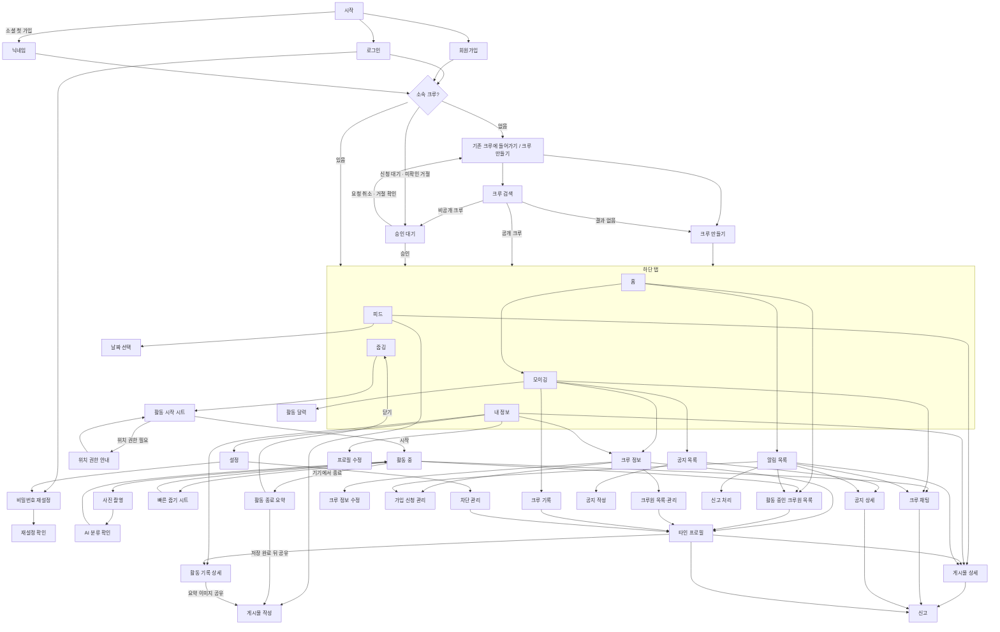

# 화면

화면마다 설계서가 한 장씩 `screens/` 에 있다. 배치·요소·상태·인터랙션·접근성은 그 장을 본다. 이 파일은 이동 지도와 색인이다.
템플릿은 `screens/_template.md`, 검사는 `python docs/screens/check.py <파일>`.

## 이동 지도

## 색인

상태: 초안 → 승인. 승인은 화면 정책에 대한 합의이며 앱 구현·실기기 검증 완료를 뜻하지 않는다. 가입 약관·개인정보 문구와 동의 저장 계약, 캐릭터 에셋은 별도 준비 항목이다.

| 번호 | 이름 | 원본 | 파일 | 상태 |
|---|---|---|---|---|
| 1-1 | 시작 | fragment_start | [1-1-start.md](screens/1-1-start.md) | 승인 |
| 1-2 | 로그인 | fragment_login | [1-2-login.md](screens/1-2-login.md) | 승인 |
| 1-3 | 회원가입 | fragment_signup | [1-3-sign-up.md](screens/1-3-sign-up.md) | 배치 승인 · 동의자료 대기 |
| 1-4 | 소셜 첫 가입 닉네임 | fragment_nickname | [1-4-nickname.md](screens/1-4-nickname.md) | 배치 승인 · 동의자료 대기 |
| 1-5 | 비밀번호 재설정 (요청·코드 입력 한 화면) | fragment_password_reset, fragment_password_reset_confirm | [1-5-reset-password.md](screens/1-5-reset-password.md) | 승인 |
| 1-6 | 크루 선택 (기존 크루에 들어가기 / 크루 만들기) | 재조립 ← fragment_hood | [1-6-create-or-join-crew.md](screens/1-6-create-or-join-crew.md) | 초안 |
| 1-7 | 크루 만들기 | 신규 (별도 화면으로 복원) | [1-7-create-crew.md](screens/1-7-create-crew.md) | 초안 |
| 1-8 | 크루 검색 | 신규 ← fragment_hood 부품 | [1-8-search-crew.md](screens/1-8-search-crew.md) | 초안 |
| 1-9 | 승인 대기 | 신규 | [1-9-pending-approval.md](screens/1-9-pending-approval.md) | 초안 |
| 1-10 | 위치 권한 안내 | 통합됨 → 4-2 시트 | [1-10-location-permission.md](screens/1-10-location-permission.md) | 통합됨 |
| 2-1 | 홈 | fragment_home | [2-1-home.md](screens/2-1-home.md) | 승인 |
| 2-2 | 활동 중인 크루원 목록 | 재조립 ← fragment_friends | [2-2-active-crew-members.md](screens/2-2-active-crew-members.md) | 승인 |
| 2-3 | 알림 목록 | fragment_notification | [2-3-notifications.md](screens/2-3-notifications.md) | 초안 |
| 3-1 | 모이깅 | 재조립 ← fragment_meet | [3-1-crew.md](screens/3-1-crew.md) | 승인 |
| 3-2 | 크루 정보 | 통합됨 → 3-11 | [3-2-crew-info.md](screens/3-2-crew-info.md) | 통합됨 |
| 3-3 | 초대 코드 | 끔 | [3-3-invite-code.md](screens/3-3-invite-code.md) | 끔 |
| 3-4 | 크루 기록 | 재조립 ← fragment_group_record | [3-4-crew-records.md](screens/3-4-crew-records.md) (3-1 탭으로 통합) | 승인 |
| 3-5 | 공지 목록 | 재조립 ← fragment_feed | [3-5-notices.md](screens/3-5-notices.md) (3-1 탭으로 통합) | 승인 |
| 3-6 | 공지 상세 | 재조립 ← fragment_post_detail | [3-6-notice-detail.md](screens/3-6-notice-detail.md) | 승인 |
| 3-7 | 크루 채팅 | fragment_chat | [3-7-crew-chat.md](screens/3-7-crew-chat.md) | 승인 |
| 3-8 | 가입 신청 관리 | 재조립 ← fragment_friends | [3-8-manage-join-requests.md](screens/3-8-manage-join-requests.md) | 초안 |
| 3-9 | 활동 달력 | 신규 | [3-9-activity-calendar.md](screens/3-9-activity-calendar.md) (3-1 탭으로 통합) | 승인 |
| 3-10 | 크루 정보 수정 | 재조립 ← fragment_meet_edit | [3-10-edit-crew.md](screens/3-10-edit-crew.md) | 초안 |
| 3-11 | 크루 정보·크루원 | 재조립 ← fragment_meet_manage | [3-11-manage-crew-members.md](screens/3-11-manage-crew-members.md) | 초안 |
| 3-12 | 공지 작성·수정 | 재조립 ← fragment_publish | [3-12-edit-notice.md](screens/3-12-edit-notice.md) | 승인 |
| 4-1 | 줍깅 대기 | 재조립 ← sheet_start | [4-1-plogging-ready.md](screens/4-1-plogging-ready.md) | 승인 |
| 4-2 | 활동 시작 시트 | sheet_start | [4-2-start-activity-sheet.md](screens/4-2-start-activity-sheet.md) | 승인 |
| 4-3 | 활동 중 | fragment_active | [4-3-activity-in-progress.md](screens/4-3-activity-in-progress.md) | 승인 |
| 4-4 | 사진 촬영 | fragment_capture | [4-4-take-photo.md](screens/4-4-take-photo.md) | 승인 |
| 4-5 | AI 분류 확인 | fragment_ai_classify | [4-5-ai-classification-review.md](screens/4-5-ai-classification-review.md) | 승인 |
| 4-6 | 빠른 줍기 시트 | sheet_pickup | [4-6-quick-pickup-sheet.md](screens/4-6-quick-pickup-sheet.md) | 승인 |
| 4-7 | 활동 종료 요약 | fragment_activity_end | [4-7-activity-summary.md](screens/4-7-activity-summary.md) | 승인 |
| 5-1 | 피드 | fragment_feed | [5-1-feed.md](screens/5-1-feed.md) | 승인 |
| 5-2 | 게시물 상세 | fragment_post_detail, sheet_post_menu | [5-2-post-detail.md](screens/5-2-post-detail.md) | 승인 |
| 5-3 | 활동 기록 상세 | fragment_record_detail, sheet_record_items | [5-3-activity-record-detail.md](screens/5-3-activity-record-detail.md) | 승인 |
| 5-4 | 타인 프로필 | fragment_user_profile, sheet_safety | [5-4-user-profile.md](screens/5-4-user-profile.md) | 승인 |
| 5-5 | 내 정보 | fragment_profile | [5-5-my-profile.md](screens/5-5-my-profile.md) | 초안 |
| 5-6 | 게시물 작성 | fragment_publish | [5-6-create-post.md](screens/5-6-create-post.md) | 승인 |
| 5-7 | 설정 | fragment_settings | [5-7-settings.md](screens/5-7-settings.md) | 초안 |
| 5-8 | 프로필 수정 | fragment_edit_profile | [5-8-edit-profile.md](screens/5-8-edit-profile.md) | 승인 |
| 5-9 | 차단 관리 | fragment_blocklist | [5-9-manage-blocks.md](screens/5-9-manage-blocks.md) | 승인 |
| 6-1 | 신고 | fragment_report | [6-1-report.md](screens/6-1-report.md) | 승인 |
| 6-2 | 신고 처리 | 신규 | [6-2-review-report.md](screens/6-2-review-report.md) | 승인 |

## 공통

- 하단 탭 5개: 홈 · 피드 · 줍깅 · 모이깅 · 내 정보. 원본 `view_bottom_nav`. 줍깅은 활동 중이면 배지. 줍깅 버튼은 처음 한 번만 4-1 온보딩을 보이고, 그 뒤로는 진행 중이면 4-3, 아니면 지금 탭 위에 4-2 시트를 띄운다
- 배경 알림창(활동 중): 거리 · 시간 · 개수 · 일시정지 여부. 포그라운드 서비스 알림. 걸음수는 측정값이 있을 때 보조 정보로 표시하고 미지원·권한 거부가 활동을 막지 않는다
- 첫 로그인·재로그인·앱 실행 때마다 `GET /users/me` 로 최신 상태를 보고 가입 미완료 → 해당 단계, 소속(MEMBER, 대기 중 승인된 경우 포함) → 홈, 비공개 크루 승인 대기(PENDING) → 1-9, NONE 이고 미확인 거절(`membership.rejection`) 있음 → 1-9 거절 안내, NONE → 1-6 으로 간다. 승인 대기는 크루원이 아니다. 위치 권한은 이 분기를 막지 않고 4-2에서만 요청한다
- 크루에 소속돼야 앱을 쓴다. 미가입자(NONE·PENDING)는 1-6·1-7·1-8·1-9 와 5-7(로그아웃·탈퇴만)만 연다. 하단 탭·알림·내 기록 등 다른 화면은 열지 않는다
- 지도 열람자는 활동 중일 필요가 없다. 2-2와 4-3의 마커는 활동 중이고 위치 공유를 켠 크루원만 표시한다. 위치 공유를 꺼도 본인 기록에는 경로가 남는다
- 진행 중 활동은 4-3으로 복구하고, 기기 종료·서버 저장 대기는 4-1 저장 대기 카드로 복구한다. 대기 기록을 새 진행 활동처럼 다시 열지 않는다
- 푸시는 인증·소속 확인 뒤 대상으로 직접 이동한다. 대상이 삭제됐거나 접근할 수 없으면 이유를 안내하고 2-3으로 간다. 미가입자는 알림 목록·기록을 열지 않고, 가입 결과 푸시를 누르면 위 분기를 따른다
- 공통 UI: `Screen`으로 안전 영역·키보드·스크롤을 처리하고 터치는 48dp 이상으로 한다. 핵심 정보는 유지하며 캐릭터·반복 설명·미리보기부터 줄인다. 프로필 소개는 2줄+더 보기
- 공통 입력: 필드 오류는 해당 입력 아래, 요청 실패는 입력 보존+재시도. 실제 제출이 계속되는 동안 취소 완료라고 안내하지 않는다. 각 화면의 자세한 정책은 `feature-scope.md`를 따른다
- 신고 진입은 대상 종류·id와 함께 이미 표시 중인 닉네임·사진·본문 앞부분을 6-1로 전달한다. 미리보기는 표시용이고 서버가 대상·권한을 검증한다. 신고 처리 6-2의 USER 추방은 3-11과 같은 확인 패턴을 재사용한다
- 끈 화면: 동네 선택 · 모임 만들기/찾기/관리/수정 · 초대 링크 · 초대 코드(3-3, 1-8 의 옛 코드 입력) · 그룹 통화 · 친구 목록 · 사용자 검색 · 모임별 기록
