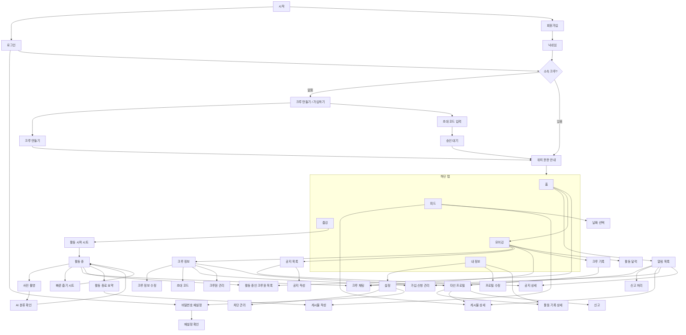

# 화면

화면마다 설계서가 한 장씩 `화면설계/` 에 있다. 배치·요소·상태·인터랙션·접근성은 그 장을 본다. 이 파일은 이동 지도와 색인이다.
템플릿은 `화면설계/_템플릿.md`, 검사는 `python docs/화면설계/check.py <파일>`.

## 이동 지도

## 색인

상태: 초안 → 승인. 파일이 없는 행은 아직 안 쓴 것.

| 번호 | 이름 | 원본 | 파일 | 상태 |
|---|---|---|---|---|
| 1-1 | 시작 | fragment_start | [1-1-시작.md](화면설계/1-1-시작.md) | 승인 |
| 1-2 | 로그인 | fragment_login | [1-2-로그인.md](화면설계/1-2-로그인.md) | 승인 |
| 1-3 | 회원가입 | fragment_signup | [1-3-회원가입.md](화면설계/1-3-회원가입.md) | 승인 |
| 1-4 | 닉네임 | fragment_nickname | [1-4-닉네임.md](화면설계/1-4-닉네임.md) | 승인 |
| 1-5 | 비밀번호 재설정·확인 | fragment_password_reset, fragment_password_reset_confirm | [1-5-비밀번호-재설정.md](화면설계/1-5-비밀번호-재설정.md) | 승인 |
| 1-6 | 크루 만들기/가입하기 | 재조립 ← fragment_hood | | |
| 1-7 | 크루 만들기 | 재조립 ← fragment_meet_create | | |
| 1-8 | 초대 코드 입력 | fragment_invite_redeem | [1-8-초대-코드-입력.md](화면설계/1-8-초대-코드-입력.md) | 승인 |
| 1-9 | 승인 대기 | 신규 | | |
| 1-10 | 위치 권한 안내 | fragment_location_gate | [1-10-위치-권한.md](화면설계/1-10-위치-권한.md) | 승인 |
| 2-1 | 홈 | fragment_home | [2-1-홈.md](화면설계/2-1-홈.md) | 승인 |
| 2-2 | 활동 중인 크루원 목록 | 재조립 ← fragment_friends | | |
| 2-3 | 알림 목록 | fragment_notification | [2-3-알림.md](화면설계/2-3-알림.md) | 승인 |
| 3-1 | 모이깅 | 재조립 ← fragment_meet | | |
| 3-2 | 크루 정보 | 재조립 ← fragment_meet_manage | | |
| 3-3 | 초대 코드 | 재조립 ← fragment_meet_manage | | |
| 3-4 | 크루 기록 | 재조립 ← fragment_group_record | | |
| 3-5 | 공지 목록 | 재조립 ← fragment_feed | | |
| 3-6 | 공지 상세 | 재조립 ← fragment_post_detail | | |
| 3-7 | 크루 채팅 | fragment_chat | [3-7-크루-채팅.md](화면설계/3-7-크루-채팅.md) | 승인 |
| 3-8 | 가입 신청 관리 | 재조립 ← fragment_friends | | |
| 3-9 | 활동 달력 | 신규 | | |
| 3-10 | 크루 정보 수정 | 재조립 ← fragment_meet_edit | | |
| 3-11 | 크루원 관리 | 재조립 ← fragment_meet_manage | | |
| 3-12 | 공지 작성·수정 | 재조립 ← fragment_publish | | |
| 4-1 | 줍깅 대기 | 재조립 ← sheet_start | | |
| 4-2 | 활동 시작 시트 | sheet_start | [4-2-활동-시작-시트.md](화면설계/4-2-활동-시작-시트.md) | 승인 |
| 4-3 | 활동 중 | fragment_active | [4-3-활동-중.md](화면설계/4-3-활동-중.md) | 승인 |
| 4-4 | 사진 촬영 | fragment_capture | [4-4-사진-촬영.md](화면설계/4-4-사진-촬영.md) | 승인 |
| 4-5 | AI 분류 확인 | fragment_ai_classify | [4-5-AI-분류-확인.md](화면설계/4-5-AI-분류-확인.md) | 승인 |
| 4-6 | 빠른 줍기 시트 | sheet_pickup | [4-6-빠른-줍기-시트.md](화면설계/4-6-빠른-줍기-시트.md) | 승인 |
| 4-7 | 활동 종료 요약 | fragment_activity_end | [4-7-활동-종료-요약.md](화면설계/4-7-활동-종료-요약.md) | 승인 |
| 5-1 | 피드 | fragment_feed | [5-1-피드.md](화면설계/5-1-피드.md) | 승인 |
| 5-2 | 게시물 상세 | fragment_post_detail, sheet_post_menu | [5-2-게시물-상세.md](화면설계/5-2-게시물-상세.md) | 승인 |
| 5-3 | 활동 기록 상세 | fragment_record_detail, sheet_record_items | | |
| 5-4 | 타인 프로필 | fragment_user_profile, sheet_safety | | |
| 5-5 | 내 정보 | fragment_profile | | |
| 5-6 | 게시물 작성 | fragment_publish | | |
| 5-7 | 설정 | fragment_settings | | |
| 5-8 | 프로필 수정 | fragment_edit_profile | | |
| 5-9 | 차단 관리 | fragment_blocklist | | |
| 6-1 | 신고 | fragment_report | | |
| 6-2 | 신고 처리 | 신규 | | |

## 공통

- 하단 탭 5개: 홈 · 피드 · 줍깅 · 모이깅 · 내 정보. 원본 `view_bottom_nav`. 줍깅은 활동 중이면 배지
- 배경 알림창(활동 중): 거리 · 시간 · 개수 · 일시정지 여부. 포그라운드 서비스 알림
- 끈 화면: 동네 선택 · 모임 만들기/찾기/관리/수정 · 초대 링크 · 그룹 통화 · 친구 목록 · 사용자 검색 · 모임별 기록
