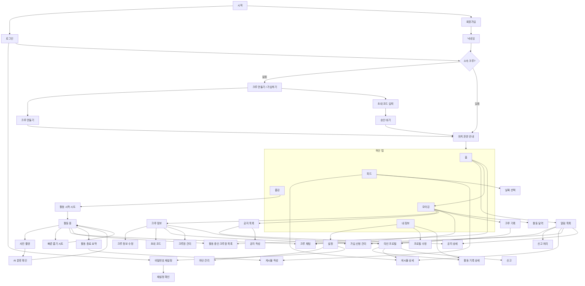

# 화면 설계

앱 프론트를 목 데이터로 먼저 완성하기 위한 문서다. 픽셀 디자인이 아니라 **화면 목록 · 이동 · 상태 · 필요한 데이터** 를 정한다.
계약(`openapi.yaml`)의 엔드포인트는 이 문서의 "필요한 데이터" 열에서 나온다. 용어는 `../CONTEXT.md`, 결정은 `기능범위.md`, 권한은 그 안의 권한표를 따른다.
시각 요소는 `design-system` 의 컴포넌트를 쓴다.

모든 목록 화면은 **로딩 · 빈 · 오류(재시도)** 세 상태를 갖는다. 표에서는 빈 상태의 문구만 적는다.

## 이동 지도

## 1. 온보딩

| # | 화면 | 진입 | 필요한 데이터 | 행동 | 빈·특수 상태 |
|---|---|---|---|---|---|
| 1-1 | 시작 | 앱 첫 실행, 로그아웃 뒤 | — | 로그인 / 회원가입 / 카카오·구글 | — |
| 1-2 | 로그인 | 1-1 | — | 이메일·비밀번호 → 토큰 | 실패 문구, 비밀번호 재설정 링크 |
| 1-3 | 회원가입 | 1-1 | — | 이메일·비밀번호 → 계정 | 중복 이메일 |
| 1-4 | 닉네임 | 1-3, 소셜 첫 로그인 | — | 닉네임 · 프로필 사진(선택) | 중복 닉네임 |
| 1-5 | 비밀번호 재설정 · 확인 | 1-2, 설정 | — | 메일 발송 → 코드·새 비밀번호 | 유지(기존) |
| 1-6 | 크루 만들기 / 가입하기 | 로그인 뒤 소속 크루가 없을 때 | — | 두 갈래 | 뒤로 가면 로그아웃 |
| 1-7 | 크루 만들기 | 1-6 | — | 이름 → 크루 생성, 본인이 크루장 | 이름 중복 |
| 1-8 | 초대 코드 입력 | 1-6 | 코드로 크루 이름 미리 보기 | 코드 → 가입 신청 | 잘못된 코드, 이미 신청 중 |
| 1-9 | 승인 대기 | 1-8 뒤, 미승인 상태로 재실행 | 내 신청 상태 | 새로고침, 신청 취소, 로그아웃 | 거절됨 → 1-6 으로 |
| 1-10 | 위치 권한 안내 | 크루 소속 확정 뒤 첫 진입 | — | 권한 요청(사용 중 → 활동 시작 때 "항상" 추가 요청) | 거부 시 앱 안에서 다시 받는 흐름 유지 |

## 2. 홈 탭

| # | 화면 | 필요한 데이터 | 행동 | 빈·특수 상태 |
|---|---|---|---|---|
| 2-1 | 홈 | 크루 이름 · 최근 7일 크루 개수 + 7일 일별 · 최근 7일 내 개수 · 활동 중인 크루원 수와 얼굴 · 캐릭터 단계(최근 14일 크루 개수, 목표) · 안 읽은 알림 여부 | 크루 카드 → 3-4 크루 기록 · 활동 중 카드 → 2-2 · 캐릭터 탭 → "최근 14일 N개, 목표까지 M개" 말풍선 · 벨 → 2-3 | 오프라인 카드(재시도) |
| 2-2 | 활동 중인 크루원 목록 | 크루원별 닉네임 · 시작 시각 · 경과 · 거리 · 개수 · 일시정지 여부 · 위치 공유 여부 | 항목 → 4-2 활동 중 지도에서 그 사람 위치로(공유 켠 사람만) | "지금 뛰는 크루원이 없어요" |
| 2-3 | 알림 목록 | 알림(종류 · 문구 · 시각 · 읽음 · 이동 대상) · 크루장이면 처리 대기(가입 신청 · 신고) | 상단 처리 대기 묶음 → 3-8/6-2 · 항목 → 대상 화면, 읽음 처리 | "새 알림이 없어요" |

## 3. 모이깅 탭 (크루)

| # | 화면 | 필요한 데이터 | 행동 | 빈·특수 상태 |
|---|---|---|---|---|
| 3-1 | 모이깅 | 크루 요약(이름 · 사진 · 인원) · 고정 공지 1건 · 안 읽은 채팅 수 · 오늘 활동한 크루원 | 크루 정보 3-2 · 공지 3-5 · 채팅 3-7 · 크루 기록 3-4 · 활동 달력 3-9 | 공지 없음 |
| 3-2 | 크루 정보 | 이름 · 소개 · 사진 · 크루장 · 크루원 목록(닉네임 · 사진 · 크루장 표시 · 누적 개수) · 초대 코드 · (크루장) 가입 신청 수 | 크루원 → 5-4 타인 프로필 · 초대 코드 → 3-3 · (크루장) 수정 3-10 · 가입 신청 3-8 · 크루원 관리 3-11 | — |
| 3-3 | 초대 코드 | 코드 · 크루 이름 | 복사 · OS 공유 · (크루장) 재발급 | — |
| 3-4 | 크루 기록 | 기간 선택(주·월·전체) · 크루 합산 개수·거리·시간 · 기간별 추이 · 카테고리별 비율 · 크루원 순위(개수 기준) · (크루장) CSV | 순위 항목 → 5-4 · (크루장) CSV → 기간 선택 → 공유 시트 | 기록 없음 |
| 3-5 | 공지 목록 | 공지(제목 · 본문 첫 줄 · 작성일 · 댓글 수 · 고정 여부) | 항목 → 3-6 · (크루장) 작성 3-12 | "아직 공지가 없어요" |
| 3-6 | 공지 상세 | 본문 · 댓글 | 댓글 작성 · 자기 댓글 삭제 · (크루장) 수정·삭제·고정 | — |
| 3-7 | 크루 채팅 | 메시지(보낸 사람 · 본문 · 시각) · 소켓 연결 상태 | 보내기 · 이전 메시지 불러오기 | 연결 끊김 배너(자동 재접속) |
| 3-8 | 가입 신청 관리 (크루장) | 신청자(닉네임 · 사진 · 신청 시각) | 승인 · 거절 | "대기 중인 신청이 없어요" |
| 3-9 | 활동 달력 | 월별: 날짜마다 활동한 크루원 얼굴 · 개수 | 날짜 → 그날 활동 목록 → 5-3 활동 기록 상세 | 활동 없는 달 |
| 3-10 | 크루 정보 수정 (크루장) | 이름 · 소개 · 사진 · 크루 목표(14일 N개) | 저장 | — |
| 3-11 | 크루원 관리 (크루장) | 크루원 목록 | 추방(확인 시트) · 위임(확인 시트) | — |
| 3-12 | 공지 작성·수정 (크루장) | — | 제목 · 본문 · 고정 여부 · 저장 | — |

## 4. 줍깅 탭 (활동)

| # | 화면 | 필요한 데이터 | 행동 | 빈·특수 상태 |
|---|---|---|---|---|
| 4-1 | 줍깅 대기 | 위치 공유 기본값 · 진행 중 활동 여부 | 시작 → 4-2 시트 · 진행 중이면 이어서 | 위치 권한 없음 → 1-10 |
| 4-2 | 활동 시작 시트 | 위치 공유 기본값 | 위치 공유 켬/끔 → 시작 | — |
| 4-3 | 활동 중 | 내 경로 · 거리 · 시간 · 개수 · 활동 중인 크루원 위치(공유 켠 사람) · 일시정지 상태 | 사진 촬영 4-4 · 빠른 줍기 4-6 · 일시정지/재개 · 내 위치로 · 채팅 3-7 · 활동 중인 크루원 2-2 · 종료 → 4-7 | GPS 약함 안내 · 화면 꺼짐 시 알림창 현황 |
| 4-4 | 사진 촬영 | — | 촬영 → 업로드 → 4-5 | 카메라 권한 없음 |
| 4-5 | AI 분류 확인 | 사진 · 찾은 물체(박스 · 카테고리 · 신뢰도) → 카테고리별 수량 | 수량 수정 · 카테고리 추가/삭제 · 저장 | 못 찾음 → 수동 추가 유도 · AI 장애 → 수동 입력 |
| 4-6 | 빠른 줍기 시트 | 카테고리 7종(4+3) | 카테고리 탭 → 수량 +1(연타 가능) → 저장 | — |
| 4-7 | 활동 종료 요약 | 거리 · 시간 · 카테고리별 개수 · 경로 지도 이미지 | 피드에 올리기 → 5-6 게시물 작성(요약 이미지 첨부) · 닫기 | 줍기 0개 안내 |

## 5. 피드 탭 · 내 정보 탭

| # | 화면 | 필요한 데이터 | 행동 | 빈·특수 상태 |
|---|---|---|---|---|
| 5-1 | 피드 | 탭(크루 전체 / 나만 보기) · 게시물(작성자 · 사진들 · 글 · 좋아요 수·여부 · 댓글 수 · 시각) · 커서 | 게시물 → 5-2 · 좋아요 · 달력 → 날짜로 건너뛰기 · 작성 5-6 | "첫 게시물을 올려 보세요" |
| 5-2 | 게시물 상세 | 게시물 · 댓글 | 댓글 작성 · 좋아요 · 자기 글 삭제 · 메뉴(신고 6-1 / 크루장 삭제) · 작성자 → 5-4 | — |
| 5-3 | 활동 기록 상세 | 날짜 · 거리 · 시간 · 카테고리별 개수 · 경로(공유 켰거나 본인) · 사진들 | 사진 → 확대 | 경로 비공개 안내 |
| 5-4 | 타인 프로필 | 닉네임 · 사진 · 소개 · 누적 개수·거리 · 팔로우 여부 · 탭(기록: 활동 달력 · 활동 목록 / 게시물: 크루 전체 게시물) | 팔로우 · 활동 → 5-3 · 게시물 → 5-2 · 메뉴(차단 · 신고 6-1 · 크루장: 추방) | 차단한 사람이면 진입 불가 |
| 5-5 | 내 정보 | 내 프로필 · 누적 개수·거리 · 활동 목록 · 내 게시물 | 활동 → 5-3 · 설정 5-7 · 수정 5-8 | 활동 없음 |
| 5-6 | 게시물 작성 | 첨부된 요약 이미지(있으면) | 사진 여러 장 · 글 · 공개 범위(크루 / 나만) · 올리기 | — |
| 5-7 | 설정 | 위치 공유 기본값 · 활동 시작 알림 켬/끔 | 프로필 편집 5-8 · 비밀번호 재설정 1-5 · 차단 관리 5-9 · 크루 나가기(크루장은 위임 안내) · 로그아웃 · 회원 탈퇴 | — |
| 5-8 | 프로필 수정 | 닉네임 · 사진 · 소개 | 저장 | 닉네임 중복 |
| 5-9 | 차단 관리 | 차단 목록 | 차단 해제 | "차단한 사람이 없어요" |

## 6. 신고

| # | 화면 | 필요한 데이터 | 행동 |
|---|---|---|---|
| 6-1 | 신고 | 대상(게시물 / 사용자) | 사유 선택 · 내용 · 제출 → 크루장에게 알림 |
| 6-2 | 신고 처리 (크루장) | 신고(대상 · 사유 · 내용 · 신고자 · 시각) | 삭제(대상 게시물·댓글) / 무시 · 사용자 신고면 추방으로 이동 |

## 공통

- **하단 탭** 5개: 홈 · 피드 · 줍깅 · 모이깅 · 내 정보. 줍깅은 활동 중이면 배지
- **알림창(배경)**: 활동 중 거리 · 시간 · 개수 · 일시정지 여부. 포그라운드 서비스 알림
- **지도**: 카카오맵 SDK 네이티브 모듈. 4-3 활동 중(내 경로·크루원 마커·내 위치로)·5-3 기록 상세(경로)·4-7 요약 이미지
- **딥링크**: 푸시 알림 → 2-3 의 이동 규칙과 같다. 초대 링크는 없다(코드만)
- **끈 화면**: 동네 선택 · 모임 만들기/찾기/관리/수정 · 초대 링크 받기 · 그룹 통화 · 친구 목록 · 사용자 검색 · 모임별 기록
